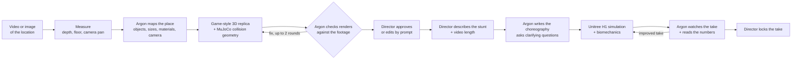

# FALLGUY: rehearse the stunt before anyone gets hurt

**Gemini 4 Argon × Google DeepMind hackathon, San Francisco**

Stunt choreography is one of the hardest jobs in film and live events. Teams spend weeks planning a single difficult stunt, but they rarely rehearse in the real location, and most of the shoot-day props aren't there during rehearsals. Performers end up improvising on the spot, and that's where injuries happen. AI video tools don't help: their clips look dramatic, but the physics is invented.

FALLGUY turns a phone video or photo of a real location into a physics-ready 3D world. A director describes a stunt in plain English. A Unitree H1 humanoid performs it in MuJoCo while we trace the biomechanics: head G, HIC15, joint torques, impact forces and spinal-load proxies. **Gemini 4 Argon** works as the Assistant Stunt Director throughout: it builds and checks the world, writes the choreography, watches every take and proposes a safer, better one.

Everything is viewed in the browser through a WebGL dashboard.

---

## The pipeline



### 1. World: a game-style replica of the real place
- **Measure.** Frames are extracted from the clip. Depth Anything V2 (metric, indoor) runs on Apple Silicon (MPS) on the still part of the shot. The floor is fitted with RANSAC, and any camera pan is tracked as a pure rotation. The result is a metric grid and a plan view. Depth is only a measuring tool: no video pixels end up in the world.
- **Map.** Argon (`gemini-4-argon`, thinking `high`) watches the clip together with the grid overlays and returns every object: walls, curtains, railings, doors, screens, furniture, plants, people. Each comes with a position, size, colour, material and hazard flag, plus the reference camera.
- **Model.** A procedural asset library (`fallguy/world/assets.py`, 36 categories plus a primitive fallback) turns each object into a clean low-poly asset with stylised materials. Examples: pleated curtains, glass railings with handrails, arches, LED screens with a lit face, box truss, tripod speakers, faceted plants, mannequins, crash mats. The assets are exported as `mesh/env.glb` for the browser and per-asset OBJs for MuJoCo. Collision uses simple primitives per object.
- **Check.** Argon compares renders of the replica with the real frames. It returns a fidelity score and per-object corrections in metres, which are applied automatically for up to 2 rounds (target score 80).
- **Edit.** The director can prompt changes such as "add a crash mat where he turns", and Argon edits the world.

### 2. Choreography: written by Argon, no hardcoded stunt types
Argon turns the brief into a sequence of generic motion phases: `hold`, `move` (along a path, with a speed profile, corner radius and lean), `jump` (launch velocity and rotations), `fall`, `air` (pose schedule) and `land` (compliance). It also writes the **tunables** the loop is allowed to change and a **target** (a crash mat or a finish zone). When the brief is ambiguous, Argon asks first, for example "is left the camera's left?".

### 3. Simulation: Unitree H1 + traced biomechanics
- The performer is always the **Unitree H1** from MuJoCo Menagerie.
- **Ground phases** are scripted: the pelvis follows the plan and the feet are planted with leg IK. **MuJoCo inverse dynamics** (`mj_inverse`) recovers the joint torques and ground reaction forces the motion needs, the way gait labs do.
- **From take-off on**, it's free physics with PD-servoed limbs, so impacts and contacts are real.
- **Biomechanics:**
  - head acceleration (15 ms window) and HIC15
  - torque at every joint (knee, hip and ankle peaks in N·m)
  - ground reaction force (× body weight)
  - neck and lumbar compression proxies from internal body forces, flagged as approximations because the H1 has no neck or spine joints
  - lateral (cornering) G
  - clearance from hazards
  - a per-link stress index: load ÷ literature limit, green / amber / red
- **Gates:**
  - **Gate 1 (physics and biomechanics):** literature injury criteria, with the blueprint's 8 G shown as the conservative stunt target. No hazard collisions, enough clearance, landing on target.
  - **Gate 2 (Argon's visual critique):** Argon judges the rendered take.
  - **Gate 3:** the director's lock.

### 4. Self-improvement: one take at a time
Argon watches the rendered take (long-video understanding at 8 fps) and reads the MuJoCo numbers as ground truth. It writes a timestamped critique and proposes concrete changes. FALLGUY applies them, simulates the next take, critiques it again, and records every take in a convergence table.

**Example (hallway video, "runs towards the camera and takes a left turn", 6 s):**

| Take | Change | Result |
|---|---|---|
| v1 | Argon's first choreography: 3.8 m/s | Gate 1 fail: right shoulder 1.9 cm from the curtain wall; knee/ankle torque red. Score 82 |
| v2 | Argon: slower (3.2 m/s), wider turn, smoother accel/brake | Gate 1 pass: 7.9 cm clearance, head 3.2 G, HIC15 1.7, 0.51 g cornering. **Score 97** |

---

## Quick start

Requirements: macOS on Apple Silicon (tested on M4) or Linux, Python 3.12, `uv`, and a Gemini API key with access to `gemini-4-argon`.

```bash
# 1. Python environment
uv venv --python 3.12 .venv
uv pip install --python .venv/bin/python -r fallguy/requirements.txt

# 2. Unitree H1 assets (MuJoCo Menagerie, sparse checkout)
git submodule update --init --filter=blob:none models/mujoco_menagerie
git -C models/mujoco_menagerie sparse-checkout set unitree_h1

# 3. Argon key: one line, read only by the scripts, never printed
echo "YOUR_KEY" > ~/.argon_token && chmod 600 ~/.argon_token

# 4. Run the dashboard
.venv/bin/python -m fallguy.app --port 8800
# open http://127.0.0.1:8800
```

### The dashboard (`fallguy.app`)
- **World dropdown:** every built world with its Argon fidelity score. **Upload video** starts a new build with live progress.
- **World panel:** fidelity score and per-object issues, render-vs-footage thumbnails, edit-by-prompt and re-verify.
- **3D viewport (Three.js/WebGL):**
  - camera-match or free-orbit views
  - toggles for mesh, collision boxes, stress colours, follow, and the real video frame as a backdrop
  - v1 | v2 side by side, with a scrubber and speed control
- **Stunt panels (from the blueprint):**
  - Gate 1/2/3 badges
  - a convergence chart and per-take loop table: score, head G, HIC15, knee torque, GRF, clearance, landing
  - an anatomical telemetry card
  - Argon's critique
  - brief and length inputs, Argon's clarifying questions, Run and Improve

Deep link: `http://127.0.0.1:8800/?world=<world_id>&stunt=<stunt_id>&take=v2&split=1`

### Command line
```bash
# Stage 1: world
.venv/bin/python -m fallguy.world build  --media path/to/location.mov [--out worlds]
.venv/bin/python -m fallguy.world verify --world worlds/<id> --apply
.venv/bin/python -m fallguy.world edit   --world worlds/<id> --prompt "add a crash mat at the end of the hallway"
.venv/bin/python -m fallguy.world render --world worlds/<id>          # rebuild assets + renders, no Argon call

# Stages 2–4: stunt
.venv/bin/python -m fallguy.stunt plan     --world worlds/<id> --brief "runs towards the camera and takes a left turn" --duration 6
.venv/bin/python -m fallguy.stunt simulate --stunt stunts/<id> --take v1
.venv/bin/python -m fallguy.stunt critique --stunt stunts/<id> --take v1
.venv/bin/python -m fallguy.stunt improve  --stunt stunts/<id> --from v1 --to v2

# Standalone viewer
.venv/bin/python -m fallguy.viewer --world worlds/<id> [--stunt stunts/<id>]
```

For a still image, convert it to a short clip first, e.g. 3 s with the bundled ffmpeg, as done for the `screen_area` scene. Argon calls at thinking `high` take 1–5 minutes each; set `FALLGUY_ARGON_TIMEOUT=900` for long verify calls.

### Claude Code skills
- `/fallguy-world`: video → world, Argon's check, edits by prompt (`.claude/skills/fallguy-world/SKILL.md`)
- `/fallguy-stunt`: choreography → H1 simulation → critique → improved take (`.claude/skills/fallguy-stunt/SKILL.md`)

---

## Repository layout

```text
fallguy/                    # the pipeline (python -m fallguy.<module>)
├── argon.py                # Gemini 4 Argon REST client (key from ~/.argon_token, thinking high, strict JSON)
├── world/                  # stage 1: measure, Argon layout, asset library, MJCF + GLB, verify, edit
├── stunt/                  # stages 2–4: plan, simulate, critique, improve
├── engine/                 # MuJoCo scene, Unitree H1 performer, phase interpreter, sim, metrics, render
├── biomech.py              # inverse/forward dynamics loads, HIC15, stress index, literature limits
├── gates.py                # Gate 1 / Gate 2 thresholds and the stunt score
├── app/                    # FastAPI dashboard + jobs (static/ = Three.js UI)
├── viewer/                 # standalone WebGL viewer
└── CONTRACT.md             # file formats shared by every module
.claude/skills/             # fallguy-world, fallguy-stunt
worlds/, stunts/            # run outputs (git-ignored)
fallguy_blueprint.md        # the original hackathon blueprint
backend/, frontend/         # the earlier FastAPI + React MVP (tickets 01–05)
barrel_roll*.py, argon_*.py # the first Argon-planned barrel-roll prototypes
```

---

## Known limitations
- **Scale** comes from a monocular depth model plus a 1.5 m phone-height prior, so absolute sizes can be off by tens of percent (e.g. the hallway came out about 1.9 m wide versus about 3 m).
- **World fidelity** tops out around 68/100 after 2 Argon rounds on our test clips. Anything off-camera isn't modelled, and complex furniture is simplified.
- **The H1 isn't a human.** It has no neck or spine joints, so cervical and lumbar loads are proxies. Inverse-dynamics torques during scripted running are indicative: knee and ankle often read above the reference limits.
- **Argon latency** dominates: layout about 5 min, each verify round 2–6 min, each take's critique about 45 s.
- The dashboard's camera-match view uses the single reference pose; it doesn't follow a camera pan yet.

## Credits
Built at the Gemini 4 Argon hackathon with Gemini 4 Argon, MuJoCo 3.17 and MuJoCo Menagerie (Unitree H1, BSD-3), Depth Anything V2, Three.js and FastAPI.
