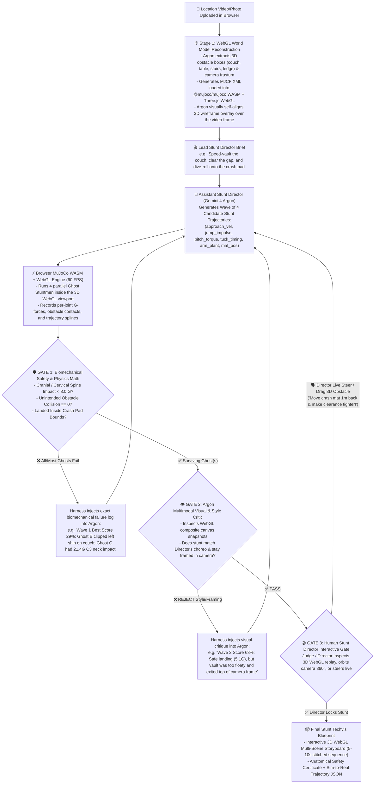

# 🎬 FALLGUY (`ragdoll`)
### The Autonomous Recursive Stunt Harness — Powered by Gemini 4 Argon + DeepMind MuJoCo (WebGL / WASM)

> **Built for the Gemini 4 Argon SF Hackathon (Google DeepMind × Cerebral Valley)**

---

## 🚀 Overview & Core Thesis

Generative video models hallucinate physics, while Hollywood stunt pre-visualization ("techvis") takes weeks of manual 3D engineering in Maya or Unreal.

**FALLGUY** is a **100% browser-based WebGL & MuJoCo WebAssembly (`@mujoco/mujoco` + Three.js) stunt choreography and biomechanical safety platform**. Given a phone video/photo of any real-world location (such as the SF hackathon venue), **Gemini 4 Argon** reconstructs the 3D collision stage in WebGL and runs a **Closed-Loop 3-Gate Stunt Verification Harness**:
1. **Spawns waves of parallel "Ghost Stuntmen" in MuJoCo WASM** directly over the location footage.
2. **Evaluates real biomechanical survivability** (Cranial/Cervical Spine impact G-forces, joint torques, obstacle clearances) + **multimodal camera framing**.
3. **Recursively self-improves** across waves while allowing the human **Lead Stunt Director** to steer the 3D scene and camera live in bullet-time.

*(Bonus Sim-to-Real capability: Because trajectories are solved in MuJoCo with real joint constraints, verified stunt trajectories can also be exported as 500Hz `.npz`/`.json` control policies for physical humanoid robots like Unitree G1).*

---

## 🎯 Why This Hits All 4 Hackathon Tracks

| Hackathon Track | How FALLGUY Pushes Gemini 4 Argon to the Limit |
| :--- | :--- |
| **1. Advanced Reasoning (Recursive Harness)** | Argon operates inside a strict **3-Gate Verification Harness**: after each wave of MuJoCo simulations, it diagnoses contact forces ($G$s), joint torques, and collision timestamps to compute exact parameter mutations for Wave $N+1$. |
| **2. Robotics & Physics (`MuJoCo WASM`)** | Runs Google DeepMind's official **`@mujoco/mujoco`** engine in the browser at 60 FPS to simulate articulated human biomechanics, momentum, friction, and spinal/cranial impact G-forces. |
| **3. World Models (Video $\rightarrow$ 3D Scene)** | Argon extracts 3D obstacle geometry (`MJCF` XML primitives) from a handheld location video/photo and visually self-aligns the 3D WebGL wireframe overlay against the real footage. |
| **4. Visual Coding (Tactical WebGL UI)** | Interactive Three.js / WebGL viewport with **Matrix Bullet-Time 360° Orbit**, **4 Parallel Colored Ghost Trajectories**, **Anatomical G-Force Injury Heatmap**, and live human-in-the-loop steering. |

---

## 🔄 The 3-Gate Recursive Stunt Harness Architecture



---

## 📊 Quantitative Self-Improvement Metrics

After every wave, the Harness computes an objective **Stunt Viability Score ($0\text{–}100\%$)** directly from MuJoCo telemetry and plots it live on the UI:

$$\text{Stunt Score} = 0.35(\text{Biomechanical Safety}) + 0.25(\text{Obstacle Clearance}) + 0.20(\text{Landing Target}) + 0.20(\text{Camera Framing})$$

| Metric | Measured Directly in `@mujoco/mujoco` WASM | Wave 1 Best (❌ Gate 1) | Wave 2 Best (❌ Gate 2) | Wave 3 Winner (✅ Locked) |
| :--- | :--- | :--- | :--- | :--- |
| **1. Cranial / Neck Impact ($G$)** | Peak head/torso acceleration (`< 8.0G` human injury limit) | `21.4 G` *(Critical Neck Risk 🔴)* | `6.4 G` *(Moderate 🟡)* | `3.5 G` *(Safe Roll Absorption 🟢)* |
| **2. Obstacle Clearance ($\text{cm}$)** | Min distance between shins/torso and obstacle box | `-7 cm` *(Shin Collision 🔴)* | `+48 cm` *(Over-jumped 🟡)* | `+11 cm` *(Tight Vault 🟢)* |
| **3. Landing Accuracy ($\text{m}$)** | Distance from pelvis rest position to crash pad center | `1.28 m` *(Missed Mat 🔴)* | `0.29 m` *(Mat Edge 🟡)* | `0.06 m` *(Bullseye 🟢)* |
| **4. Camera Framing & Style ($\%$)** | Frustum visibility % + Argon Visual Critic score | `40%` *(Fell out of frame)* | `70%` *(Apex cropped)* | `96%` *(Hero Framing 🟢)* |
| **OVERALL HARNESS SCORE** | **Plotted on Live Wave Convergence Chart** | **29 / 100** | **68 / 100** | **96 / 100** |

---

## 🛠️ Tech Stack & Quickstart

Everything runs inside a single fast web application so judges can test it live in their browser:

* **Physics Engine:** [`@mujoco/mujoco`](https://www.npmjs.com/package/@mujoco/mujoco) (Google DeepMind's official MuJoCo WebAssembly bindings)
* **3D WebGL Renderer:** `three`, `@react-three/fiber`, `@react-three/drei`
* **AI Brain & Multimodal Critic:** `@google/genai` (`gemini-4-argon`)
* **Frontend UI:** React + Vite + Tailwind CSS + Lucide Icons

```bash
# Install core dependencies
npm install @mujoco/mujoco three @types/three @react-three/fiber @react-three/drei @google/genai tailwindcss lucide-react
```

---

## 👥 2-Person, 3-Hour Build Split

### **Person 1: MuJoCo WASM + Three.js WebGL Stunt Engine (`src/physics/`)**
1. **MuJoCo WASM Loader:** Initialize `@mujoco/mujoco` in the browser with the articulated human stunt rig (`humanoid.xml`) + dynamic 3D obstacle boxes (`couch`, `table`, `ledge`, `crash_mat`).
2. **Parameterized Stunt Controller:** Execute a 3-second stunt beat from Argon's JSON control vector (`approach_vel`, `jump_impulse`, `pitch_torque`, `hip_tuck_t`, `knee_drive`, `roll_recovery`) and record 3D bone transforms + joint G-forces.
3. **Parallel Ghost Renderer & Bullet-Time Camera:** Render the **4 Parallel Ghost Stuntmen** + glowing 3D trajectory arcs + skeletal G-force colors (Red/Amber/Green bones) in Three.js over the background video plate, with a toggle between **Camera Match View** and **360° Free Orbit View**.

### **Person 2: Gemini 4 Argon Recursive Harness + Director UI (`src/agent/` & `src/ui/`)**
1. **Stage 1 (Location Video $\rightarrow$ 3D World):** Prompt `gemini-4-argon` with the uploaded venue video frame to generate the 3D obstacle layout JSON + camera FOV/pose, with a 1-step visual self-alignment check.
2. **Stage 2 (The 3-Gate Recursive Harness):** Run the autonomous wave loop (`Wave 1` $\rightarrow$ `Wave 2` $\rightarrow$ `Wave 3`), feeding MuJoCo WASM's G-force/collision telemetry + `canvas.toDataURL()` WebGL screenshots back to `gemini-4-argon` until Gates 1 & 2 pass.
3. **Stage 3 (Tactical Director HUD & Multi-Scene Timeline):**
   * Live **Biomechanical Skeleton Heatmap** (Head, Neck, Spine, Knees G-force meter).
   * **Wave Convergence Chart** (`29%` $\rightarrow$ `68%` $\rightarrow$ `96%`).
   * **3-Shot Sequence Timeline** to stitch 2–3 stunt beats into a continuous 8–10 second action sequence.
   * **Interactive Director Steer Controls:** Drag obstacles in 3D, orbit camera 360°, or click quick Director Steer buttons (*"Higher Vault"*, *"Tighter Clearance"*, *"Flip at Apex"*).

---

## 🧰 Agent Skills Included in `.agents/skills/`
This repository comes pre-configured with **47 agent skills** in `.agents/skills/` (including Matt Pocock's engineering workflow skills like `grill-me`, `to-spec`, `to-tickets`, `implement`, `tdd` and UI skills like `baseline-ui`, `improve-ui`, `component-canvas`).
