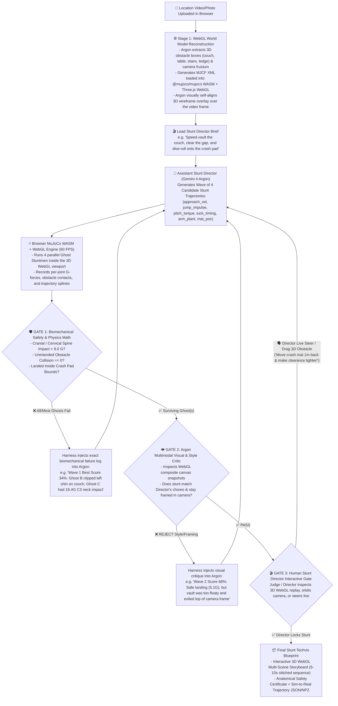

# 🎬 FALLGUY: The Autonomous Recursive Stunt Harness (WebGL + MuJoCo WASM)
**Gemini 4 Argon SF Hackathon Blueprint (Google DeepMind × Cerebral Valley)**

> [!IMPORTANT]
> **The SF Hackathon Winning Thesis:**
> Most MuJoCo hackathon demos run offline in a boring grey desktop window. **FALLGUY** is a **live, deployed WebGL & MuJoCo WASM (`@mujoco/mujoco` + Three.js) web platform** that judges can open and interact with in their browser.
> Given a phone video/photo of any real location (like the SF hackathon venue), **Gemini 4 Argon** reconstructs the 3D collision stage in WebGL and runs a **3-Gate Recursive Stunt Verification Harness**—launching waves of **parallel Ghost Stuntmen** in MuJoCo, measuring **anatomical spinal/cranial G-forces**, and self-improving across iterations while the human Stunt Director steers the 3D scene live.

---

## 1. Why This Beats Every Other SF Hackathon Team

| What Average SF Teams Build | What FALLGUY Does Instead |
| :--- | :--- |
| Offline Python script on one laptop that judges can't touch | **100% Browser WebGL + `@mujoco/mujoco` WASM** deployed live so judges can orbit the 3D camera, drag crash mats, and steer the agent themselves. |
| Single blind LLM attempt that flops on the floor | **Parallel Ghost Rollouts (Argon Tree Search):** Simulates 4 ghost stuntmen simultaneously per wave (Red/Amber/Blue/Green trajectories) and prunes unsafe branches. |
| Generic "reward = +1" RL metric | **Biomechanical Injury & Fracture Telemetry:** Live 3D skeletal stress heatmap tracking Cervical Spine ($G$), Cranial Impact ($G$), Knee Torque ($\text{N}\cdot\text{m}$), and Obstacle Clearance ($\text{cm}$). |
| Empty grey grid world | **Real-World Video Grounded:** 3D WebGL wireframe obstacles + humanoid trajectories overlaid directly on the moving phone video of the hackathon venue (with an optional 1-click export to humanoid robots later). |

---

## 2. The Recursive Stunt Harness Loop (3-Gate Verification)

The core of the project is the **Recursive Verification Harness** that traps the Assistant Stunt Director (`gemini-4-argon`) in an evolutionary physics loop until all 3 Gates pass:



---

## 3. Quantitative Self-Improvement Metrics (Shown Live in UI)

Judges see an undeniable, mathematical **Stunt Viability Score ($0\text{–}100\%$)** climb across Waves 1, 2, and 3:

$$\text{Stunt Score} = 0.35(\text{Biomechanical Safety}) + 0.25(\text{Obstacle Clearance}) + 0.20(\text{Landing Target}) + 0.20(\text{Camera Framing})$$

| Metric | Measured Directly in `@mujoco/mujoco` WASM | Wave 1 Best (❌ Gate 1) | Wave 2 Best (❌ Gate 2) | Wave 3 Winner (✅ Locked) |
| :--- | :--- | :--- | :--- | :--- |
| **1. Cranial / Neck Impact ($G$)** | Peak head/torso acceleration (`< 8.0G` human injury limit) | `21.4 G` *(Critical Neck Risk 🔴)* | `6.4 G` *(Moderate 🟡)* | `3.5 G` *(Safe Roll Absorption 🟢)* |
| **2. Obstacle Clearance ($\text{cm}$)** | Min distance between shins/torso and obstacle box | `-7 cm` *(Shin Collision 🔴)* | `+48 cm` *(Over-jumped 🟡)* | `+11 cm` *(Tight Vault 🟢)* |
| **3. Landing Accuracy ($\text{m}$)** | Distance from pelvis rest position to crash pad center | `1.28 m` *(Missed Mat 🔴)* | `0.29 m` *(Mat Edge 🟡)* | `0.06 m` *(Bullseye 🟢)* |
| **4. Camera Framing & Style ($\%$)** | Frustum visibility % + Argon Visual Critic score | `40%` *(Fell out of frame)* | `70%` *(Apex cropped)* | `96%` *(Hero Framing 🟢)* |
| **OVERALL HARNESS SCORE** | **Plotted on Live Wave Convergence Chart** | **29 / 100** | **68 / 100** | **96 / 100** |

---

## 4. The WebGL + `@mujoco/mujoco` Stack (Zero Python Required if Desired!)

Google DeepMind provides the official **`@mujoco/mujoco`** WebAssembly package on npm, which runs full MuJoCo physics directly inside the browser alongside **Three.js / React Three Fiber**:

```bash
# Install DeepMind's official MuJoCo WASM + Three.js WebGL stack
npm install @mujoco/mujoco three @types/three @react-three/fiber @react-three/drei @google/genai tailwindcss lucide-react
```

### Why This Stack Is Fast to Build in 2–3 Hours (2 People):
1. **Everything Runs in One Web App (Deployable to Vercel / Cloudflare Pages in 10 seconds):**
   * Judges can scan a QR code on your table or click your link and **run the WebGL MuJoCo simulation right on their own laptop/phone**!
2. **Instant 3D Interactive Camera + Video Overlay:**
   * In Three.js, the uploaded moving phone video sits on a background video plane synced to the virtual camera (`VideoTexture`), while the **3D MuJoCo Humanoid + 3D Wireframe Obstacles + Glowing Trajectory Ribbons** render right on top in WebGL at 60 FPS!
   * At any moment, the Director (or Judge!) can toggle from **"Camera Match View"** (locked to the phone video) to **"Free 3D Director Orbit View"** (orbiting 360° around the stunt in 3D space while the ghost stuntmen jump in slow-motion!).

---

## 5. 2-Person, 3-Hour Build Split for Tomorrow

### **Person 1: MuJoCo WASM + Three.js WebGL Stunt Engine (`src/physics/`)**
1. Load `@mujoco/mujoco` WASM in the browser with the articulated human stuntman (`humanoid.xml`) + dynamic obstacle boxes (`couch`, `table`, `ledge`, `crash_mat`).
2. Build the **Parameterized Stunt Controller** (executes a 3-second stunt beat from Argon's JSON control vector: `approach_vel`, `jump_impulse`, `pitch_torque`, `hip_tuck_t`, `knee_drive`, `roll_recovery`) and records the 3D bone transforms + joint G-forces.
3. Render the **4 Parallel Ghost Stuntmen** + glowing 3D trajectory arcs + skeletal G-force colors (Red/Amber/Green bones) in Three.js over the background video plate.

### **Person 2: Gemini 4 Argon Recursive Harness + Director UI (`src/agent/` & `src/ui/`)**
1. **Stage 1 (Video $\rightarrow$ 3D World):** Prompt `gemini-4-argon` with the uploaded venue video frame to generate the 3D obstacle layout JSON + camera FOV/pose, with a 1-step visual self-alignment check.
2. **Stage 2 (The 3-Gate Recursive Harness):** Run the autonomous wave loop (`Wave 1` $\rightarrow$ `Wave 2` $\rightarrow$ `Wave 3`), feeding MuJoCo WASM's G-force/collision telemetry + `canvas.toDataURL()` WebGL screenshots back to `gemini-4-argon` until Gates 1 & 2 pass.
3. **Stage 3 (Tactical Director HUD & Multi-Scene Timeline):**
   * Live **Biomechanical Skeleton Heatmap** (Head, Neck, Spine, Knees G-force meter).
   * **Wave Convergence Chart** (`29%` $\rightarrow$ `68%` $\rightarrow$ `96%`).
   * **3-Shot Sequence Timeline** to stitch 2–3 stunt beats into a continuous 8–10 second action sequence.
   * **Interactive Judge Controls:** Drag obstacles in 3D, orbit camera 360°, or click quick Director Steer buttons (*"Higher Vault"*, *"Tighter Clearance"*, *"Flip at Apex"*).
